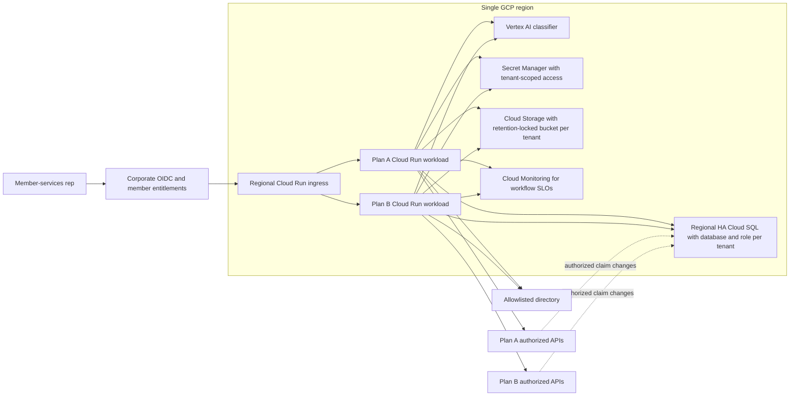

# Proposed production architecture

Each workload contains the workflow, tenant-scoped knowledge index, tool gateway and approval checks. The database stores approved filing intents and recovery state. The grievance systems of record must provide durable operation lookup and deduplication. The claims projection is conditional on an authorized feed and freshness contract.
